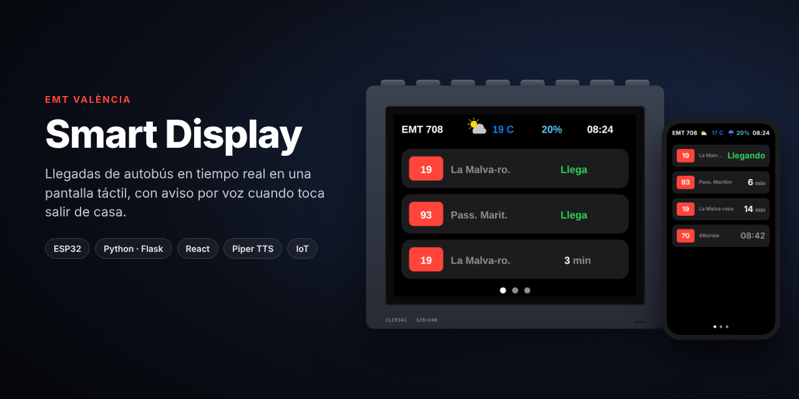
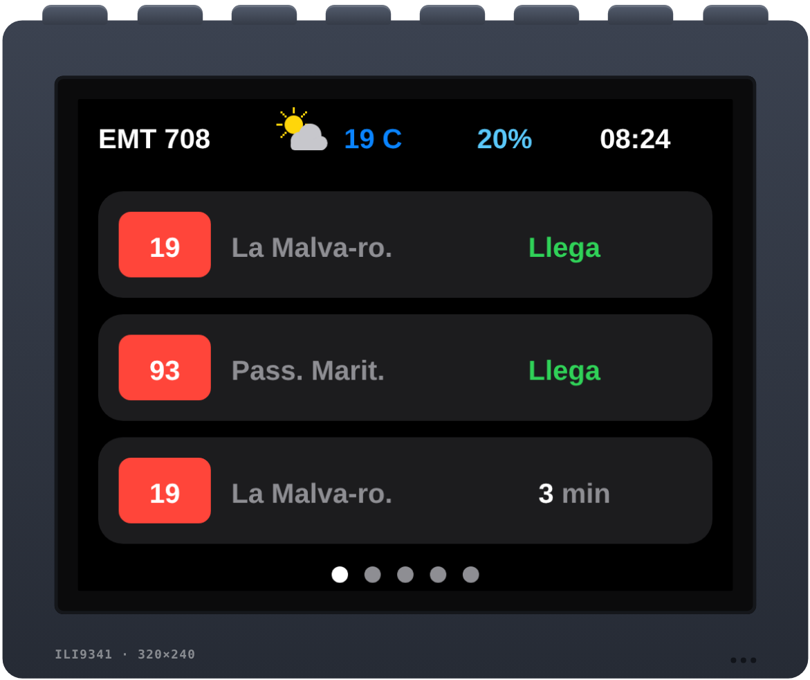
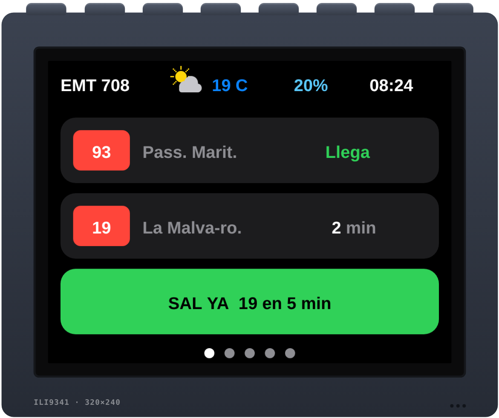
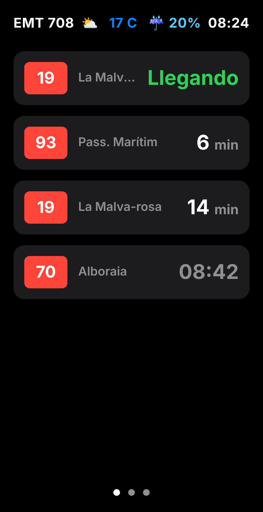
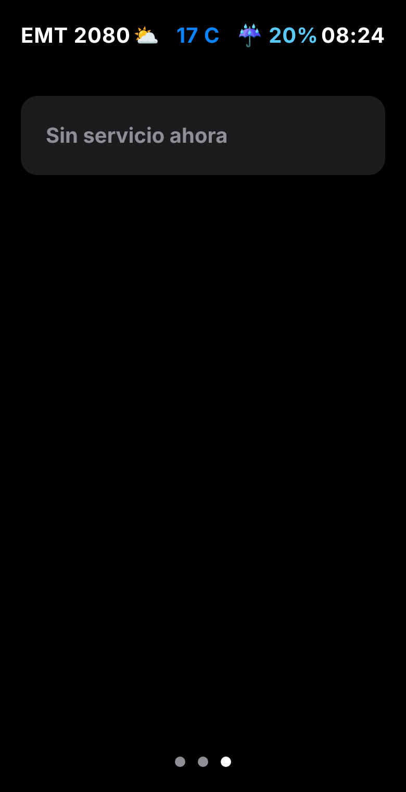
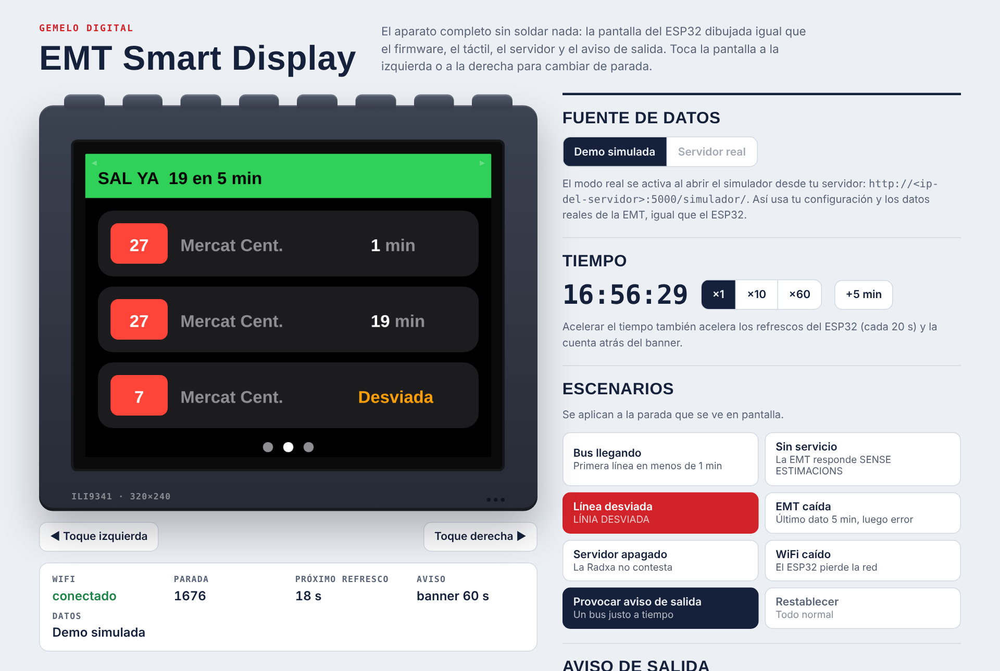
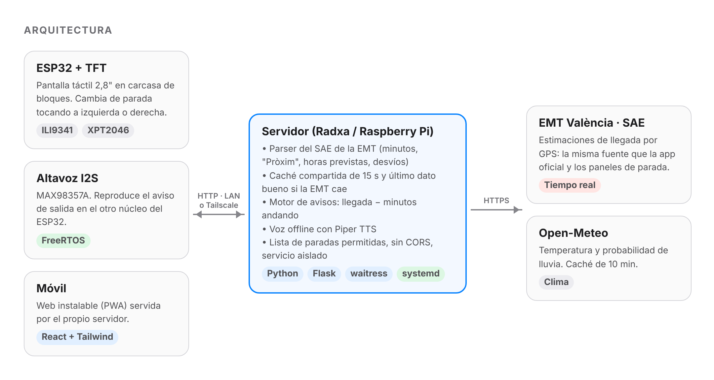
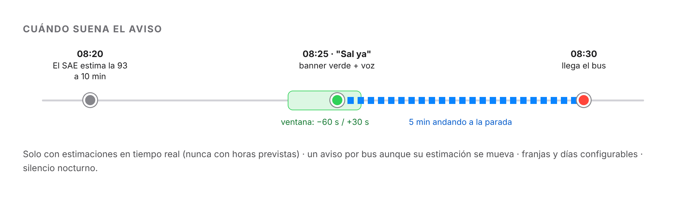
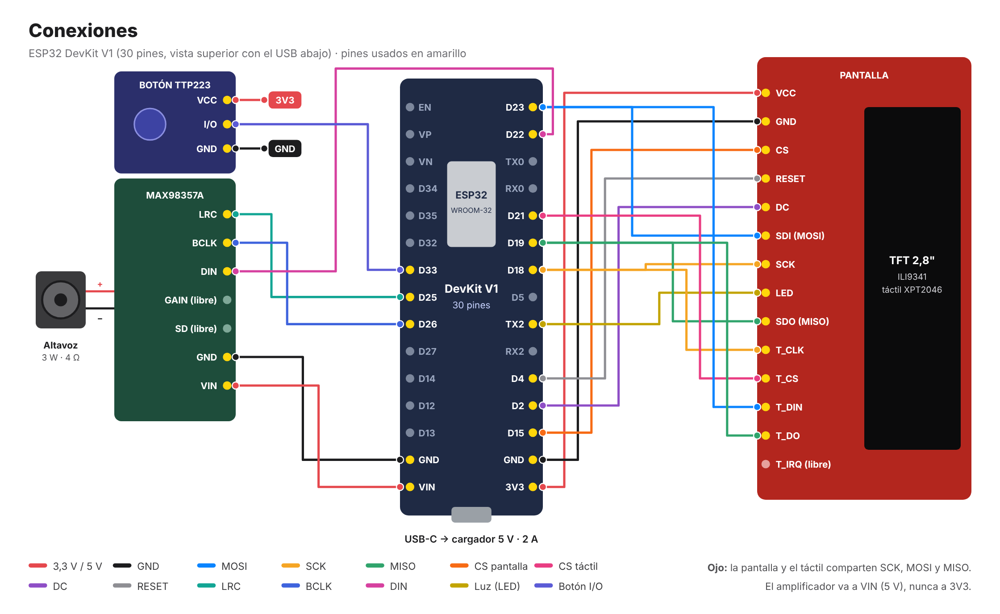

<p align="center">
  
</p>

<p align="center">
  <a href="../../actions/workflows/ci.yml"></a>
  
  
  
  
  
</p>

<p align="center">
  <a href="https://ricardoedreirapenas.github.io/emt-valencia-smart-display/"></a>
</p>

# EMT València Smart Display

Pantalla táctil que muestra **en tiempo real** cuándo llegan los autobuses de la EMT de València a tus paradas, con el tiempo, la probabilidad de lluvia y la hora. Cuando toca salir de casa para no perder el bus, **lo dice en voz alta**.

El sistema tiene tres piezas: un **ESP32** con pantalla de 2,8" montado en una carcasa de bloques de construcción, un **servidor** y una **web instalable** para el móvil. El servidor se puede montar de dos formas, con la misma API:

| | **Opción A · Placa en casa** | **Opción B · Cloudflare, sin placa** |
|---|---|---|
| Dónde corre | Radxa ROCK 3C o Raspberry Pi en tu red ([`server/`](server/)) | Cloudflare Workers, en internet ([`cloud/`](cloud/)) |
| Coste | La placa (≈ 40–60 €) y su consumo | 0 €: cabe de sobra en el plan gratuito |
| Voz del aviso | Piper, offline en la placa | Workers AI (Deepgram Aura 2, español) |
| Acceso | Solo desde tu WiFi (o VPN) | Desde cualquier sitio, con clave |
| ESP32 | `http://<ip-de-la-placa>:5000` | `https://…workers.dev` + `API_KEY` |
| Para quién | Quieres todo en casa y sin depender de nadie | No quieres montar ni mantener otra placa |

Se elige en [Puesta en marcha](#1-servidor-elige-a-o-b). Las dos opciones pasan los mismos tests: el Worker se comprueba contra las salidas del servidor en Python ([paridad](#calidad)).

**Lo más destacable**

- **La misma fuente que la app oficial.** Consulta directamente el SAE de la EMT (el sistema de seguimiento por GPS de los autobuses), sin librerías intermedias.
- **El tiempo de un vistazo.** Icono del cielo (sol, nubes, lluvia, tormenta, niebla, nieve; luna de noche), temperatura y probabilidad de lluvia de [Open-Meteo](https://open-meteo.com/).
- **Distingue lo real de lo previsto.** Las estimaciones en tiempo real se muestran en blanco; las horas teóricas, en gris; "Pròxim" se convierte en *Llegando* y las líneas desviadas se marcan en naranja.
- **Aviso de salida por voz.** Calcula `llegada del bus − minutos andando` y avisa en el último minuto, con voz neuronal (Piper offline en la placa, o Workers AI en Cloudflare).
- **Robusto.** Caché compartida de 15 s; si la EMT no responde, muestra el último dato bueno y lo marca.
- **Seguro por diseño.** Lista de paradas permitidas, sin CORS, servicio aislado con systemd (A) o clave de acceso y HTTPS con certificados verificados (B). Más de 90 tests automáticos. Ver [docs/SEGURIDAD.md](docs/SEGURIDAD.md).

---

## Capturas

| Pantalla del dispositivo | Aviso de salida |
|:---:|:---:|
|  |  |
| Próximas llegadas de la parada. Se cambia de parada tocando a izquierda o derecha. | Banner verde abajo, en el sitio de la 3.ª llegada (la parada, el tiempo y la hora siguen a la vista), y voz: *"Sal ya. La 93 hacia Pass. Marítim llega en 6 minutos."* |

| Web en el móvil | Sin servicio |
|:---:|:---:|
|  |  |

> Las capturas de la web son del servidor real con datos de demostración. La pantalla del dispositivo está capturada del [gemelo digital](#gemelo-digital), que la dibuja con la lógica del firmware.

---

## Gemelo digital

<p align="center"></p>

**[▶ Probar la demo](https://ricardoedreirapenas.github.io/emt-valencia-smart-display/)**, sin instalar nada.

Un simulador en el navegador para probar el sistema **sin montar el hardware**. La pantalla se dibuja con el mismo código que el firmware, traducido línea a línea: coordenadas, colores, textos, refrescos cada 20 s, banner de 60 s y validaciones. El táctil funciona haciendo clic a la izquierda o a la derecha.

- **EMT en directo** (el modo de la [demo publicada](https://ricardoedreirapenas.github.io/emt-valencia-smart-display/)). Llegadas reales de cinco paradas de València, tiempo real de Open-Meteo y avisos de salida sobre datos reales. Como la EMT no deja que otras webs le pidan datos, pasan por un intermediario propio ([`proxy-demo/`](proxy-demo/), un Cloudflare Worker) que solo atiende esas cinco paradas y guarda cada respuesta 20 s: la EMT recibe como mucho 5 consultas cada 20 s, haya los visitantes que haya.
- **Tu servidor.** Abre `http://<ip-del-servidor>:5000/simulador/` y usa tu propio servidor, tus paradas y tu configuración, como el ESP32.
- **Demo simulada.** Servidor simulado (misma lógica que `app.py` y `avisos.py`) con el tiempo acelerable (×10, ×60) y escenarios a un clic: bus llegando, sin servicio, línea desviada, EMT caída, servidor apagado, WiFi caído, aviso de salida con voz y los siete iconos del tiempo, de día y de noche.

**Lo que encontró antes de montar nada**, ya corregido en el firmware y el servidor:

| Escenario | Fallo | Arreglo |
|---|---|---|
| Línea desviada en una parada con 3+ buses | La desviada iba al final de la lista y la pantalla solo muestra 3 tarjetas: nunca se veía | El servidor la coloca en la 3.ª posición (con test) |
| Se cae el WiFi | La pantalla seguía mostrando minutos de hace rato sin avisar | Aviso **Sin WiFi** en rojo y datos frescos al reconectar |
| Termina un aviso sin WiFi | El banner verde quedaba a medio borrar | Se borra el hueco del aviso (hoy el banner va abajo, en el sitio de la 3.ª llegada) |


<p align="center"></p>

El ESP32 y el móvil nunca hablan con la EMT: solo con el servidor de casa. Así hay **una sola consulta** a la EMT por parada cada 15 s, aunque haya varias pantallas, y cualquier cambio en la fuente de datos se arregla en un único sitio.

### Qué devuelve la EMT y cómo se interpreta

El SAE responde XML. El campo `minutos` significa cosas distintas según el caso, y la librería de referencia no los contemplaba todos. Estos formatos están verificados con respuestas reales, guardadas como casos de prueba en [`server/tests/fixtures`](server/tests/fixtures):

| `minutos` en el XML | Significado | En la pantalla |
|---|---|---|
| `37 min.` | Estimación en tiempo real | **37 min** (blanco) |
| `Pròxim` (en valenciano) | El bus está llegando | **Llegando** (verde) |
| `02:57:45` | Hora prevista, sin GPS (2.º bus de la línea, nocturnos…) | 02:57 (gris) |
| vacío + `<error>SENSE ESTIMACIONS</error>` | Sin servicio | *Sin servicio ahora* |
| `LÍNIA DESVIADA` | Línea desviada por obras o actos | **Desviada** (naranja) |

### Precisión medida

El 31/10/2026, de 07:38 a 07:47, se consultaron 8 paradas cada 30 s (136 peticiones, 0 errores, 70-150 ms por respuesta) y se siguió cada autobús hasta que pasó por la parada:

| Medida | Resultado |
|---|---|
| Error medio de la estimación ("N min.") | **0,9 min** (sesgo +0,2 min) |
| Estimaciones dentro de ±1 min | **60 %**, con una resolución de 1 min en origen |
| "Pròxim" | el bus pasa de media **1,1 min** después (máximo 3,2) |

Conclusión: las estimaciones del SAE son fiables, así que el servidor las usa tal cual. Una corrección de +0,5 min por el truncado de los minutos **no mejoraba** el resultado y se descartó. Es una muestra pequeña: la hoja de ruta incluye medirlo de forma continua.

### Aviso de salida

<p align="center"></p>

El audio se genera en el servidor con [Piper](https://github.com/OHF-Voice/piper1-gpl) en cuanto nace el aviso, y el ESP32 lo reproduce por I2S **en el otro núcleo** (tarea FreeRTOS), para que dibujar la pantalla no corte el sonido. Sin voz instalada, suena un tono de dos notas.

---

## Hardware

> 🛠️ **[Guía de montaje paso a paso](docs/MONTAJE.md)**: lista de compra con precios, cableado, calibración, prueba de audio, medidas para la carcasa y solución de problemas.

<p align="center"></p>

| Componente | Notas |
|---|---|
| ESP32 DevKit V1 (WROOM, 30 pines) | No necesita PSRAM: el audio se lee en streaming |
| Pantalla TFT SPI ILI9341 2,4" o 2,8" con táctil XPT2046 | |
| Amplificador I2S MAX98357A + altavoz 3 W / 4 Ω | Opcional, para los avisos de voz |
| Radxa ROCK 3C, Raspberry Pi o cualquier Linux | Servidor siempre encendido |
| Cargador USB 5 V / 2 A | 2 A por los picos del altavoz |
| Cables Dupont y carcasa de bloques | |

**Coste total aproximado: 25-45 €** (sin contar el servidor). Detalle en la [lista de compra](docs/MONTAJE.md#1-lista-de-compra).

### Cableado

<table>
<tr><td valign="top">

**Pantalla y táctil**

| TFT | ESP32 |
|---|---|
| VCC, LED | 3V3 |
| GND | GND |
| CS | GPIO 15 |
| RESET | GPIO 4 |
| DC | GPIO 2 |
| SDI / MOSI · T_DIN | GPIO 23 |
| SCK · T_CLK | GPIO 18 |
| SDO / MISO · T_DO | GPIO 19 |
| T_CS | GPIO 21 |

</td><td valign="top">

**Audio (MAX98357A)**

| Módulo | ESP32 |
|---|---|
| VIN | 5V / VIN |
| GND | GND |
| BCLK | GPIO 26 |
| LRC | GPIO 25 |
| DIN | GPIO 22 |
| SD, GAIN | sin conectar |

</td></tr>
</table>

---

## Puesta en marcha

### 1. Servidor: elige A o B

#### Opción A · Raspberry / Radxa en casa

```bash
git clone https://github.com/RicardoEdreiraPenas/emt-valencia-smart-display.git
cd emt-valencia-smart-display/server
python3 -m venv .venv && source .venv/bin/activate
pip install -r requirements.txt

# Opcional: voz para los avisos
pip install -r requirements-voz.txt
python3 -m piper.download_voices --data-dir voces es_ES-davefx-medium

python3 app.py
curl http://localhost:5000/api/parada/708
```

Para dejarlo como servicio que arranca solo y está aislado del sistema, sigue las instrucciones de [`deploy/dashboard-emt.service`](deploy/dashboard-emt.service).

#### Opción B · Cloudflare Workers, sin placa

Necesitas una cuenta gratuita de Cloudflare y Node.js 20 o superior.

```bash
cd emt-valencia-smart-display/cloud
npx wrangler login                    # una vez
# edita wrangler.toml: PARADAS, CLIMA, REGLAS y SILENCIO
npm run desplegar                     # compila la web, junta el gemelo y publica
openssl rand -hex 20 | tee ~/emt-clave.txt | npx wrangler secret put API_TOKEN
```

Te queda en `https://emt-smart-display.<tu-subdominio>.workers.dev`. En el navegador, entra una vez en `/entrar` con la clave; en el ESP32, pon la dirección en `SERVER_ROOT` y la clave en `API_KEY`. Paso a paso, con la voz, los límites del plan gratuito y cómo probarlo: **[docs/CLOUDFLARE.md](docs/CLOUDFLARE.md)**.

### 2. Configuración

Todo lo personal está en [`server/config.py`](server/config.py) (opción A) o en `[vars]` de [`cloud/wrangler.toml`](cloud/wrangler.toml) (opción B), con los mismos campos:

```python
PARADAS = [708, 1676, 2080, 1619, 697]  # las que muestra la pantalla
CLIMA = {"lat": 39.4697, "lon": -0.3774}

REGLAS = [                            # avisos de salida
    {"parada": 708, "andando_min": 5, "lineas": None,
     "dias": [0, 1, 2, 3, 4], "desde": "07:30", "hasta": "09:00"},
]
SILENCIO = ("23:00", "07:00")         # nunca suena en esta franja
```

El número de parada está en el poste de cada parada y en la app de la EMT.

### 3. Firmware (ESP32)

1. Instala el **core Arduino-ESP32 3.x** y las librerías `ArduinoJson` (v7), `Adafruit GFX Library`, `Adafruit ILI9341` y `XPT2046_Touchscreen`.
2. En `firmware/dashboard_emt/`:
   - copia `secrets.example.h` como `secrets.h` y pon tu WiFi (está en `.gitignore`); con la opción B, también `API_KEY`;
   - en `config.h`, pon la dirección del servidor (`http://<ip>:5000` o `https://…workers.dev`) y las mismas paradas que en el servidor.
3. Sube el sketch. **Calibrar el táctil:** abre el Monitor Serie (115200), toca a izquierda y derecha y ajusta `TOUCH_X_MITAD` (y `TOUCH_INVERTIDO` si va al revés).

### 4. Web para el móvil

```bash
cd frontend
npm ci
npm run build      # genera server/web, que sirve el propio servidor
```

Abre `http://<ip-del-servidor>:5000` (A) o la dirección de tu Worker (B) en el móvil y añádela a la pantalla de inicio. Con la opción A, para usarla fuera de casa accede por VPN (por ejemplo Tailscale); **no abras el puerto en el router**. Con la opción B ya funciona desde cualquier sitio.

---

## API

| Método | Ruta | Descripción |
|---|---|---|
| GET | `/api/parada/<id>` | Llegadas normalizadas, clima con icono y estado del dato (`obsoleto`, `edad_dato_s`). 404 si la parada no está configurada |
| GET | `/api/config` | Paradas configuradas |
| GET | `/api/aviso` | Aviso de salida vigente, o 204 |
| GET | `/api/audio/<id>.wav` | Audio del aviso (PCM 16 bits mono) |
| GET | `/api/salud` | Estado del servicio |
| GET | `/simulador/` | Gemelo digital del aparato |

En la opción B, todas las rutas `/api/` (menos `/api/salud`) piden la clave: cabecera `X-Clave` (ESP32) o la cookie que deja `/entrar` (navegador). Sin clave responden 401.

<details>
<summary>Ejemplo de respuesta de <code>/api/parada/708</code></summary>

```json
{
  "success": true,
  "parada": 708,
  "clima": "17 C",
  "prob_lluvia": "20%",
  "icono_clima": "parcial",
  "noche": false,
  "llegadas": [
    {"linea": "19", "destino": "La Malva-rosa", "minutos": 37, "llegando": false,
     "hora": null, "tiempo_real": true, "texto": "37", "llega_a": 1793409591},
    {"linea": "19", "destino": "La Malva-rosa", "minutos": null, "llegando": false,
     "hora": "02:57", "tiempo_real": false, "texto": "02:57", "llega_a": 1793411820}
  ],
  "avisos": [],
  "servidor_ts": 1793407371,
  "edad_dato_s": 0,
  "obsoleto": false
}
```

`llega_a` es la hora prevista absoluta (epoch): permite cuentas atrás continuas sin volver a preguntar.
</details>

---

## Calidad

```bash
cd server && pip install pytest && python -m pytest -v tests   # 35 tests
cd cloud && npm test                                           # 56 tests, sin dependencias
```

- **Parser del SAE:** respuestas reales de la EMT ("Pròxim", horas previstas, líneas desviadas, una parada con 28 buses) y cruce de medianoche.
- **Avisos:** franjas, silencio nocturno, no repetir el mismo bus, filtro de líneas y WAV válido.
- **Tiempo:** traducción de los códigos WMO a iconos, con una respuesta real de Open-Meteo.
- **Paridad A/B:** `server/tests/paridad.py` guarda lo que devuelve el servidor en Python con respuestas reales de la EMT (también el día del cambio de hora), los 101 códigos del tiempo, una semana de franjas de aviso, una secuencia de avisos y el tono; el Worker tiene que dar exactamente lo mismo, ids de aviso incluidos.
- **Worker de Cloudflare:** clave (cabecera, cookie, intentos fallidos), caché, último dato bueno, Open-Meteo caído, avisos con voz y su cabecera WAV, y voz caída (tono).
- **Intermediario de la demo:** solo paradas permitidas, solo GET, CORS restringido y caché de 20 s (`cd proxy-demo && npm test`).
- **Gemelo digital:** se sirve desde el servidor y cumple su política de seguridad (sin código en línea).
- **Seguridad:** paradas no permitidas, CORS, cabeceras, errores sin detalles internos, IDs de audio, rutas de API y bomba XML.

La [CI](.github/workflows/ci.yml) ejecuta los tests de las dos opciones, comprueba que el Worker se empaqueta, compila la web y **compila el firmware para ESP32 en sus dos variantes** (http en casa y https con clave) en cada cambio.

## Estructura

```
├── server/              Servidor Python (Flask + waitress)
│   ├── app.py           API, parser del SAE, caché y web estática
│   ├── avisos.py        Motor de avisos de salida y voz
│   ├── config.py        Tus paradas y avisos
│   ├── simulador/       Gemelo digital (se sirve en /simulador/)
│   └── tests/           35 tests + respuestas reales de la EMT y Open-Meteo
├── cloud/               Opción B: el mismo servidor en Cloudflare Workers
│   ├── src/             API, lógica (port de app.py y avisos.py) y estado en la Cache API
│   ├── test/            56 tests, incluida la paridad con Python
│   └── wrangler.toml    Tus paradas y avisos (opción B)
├── firmware/
│   └── dashboard_emt/   Sketch del ESP32 (pantalla, táctil, audio I2S, HTTPS)
├── frontend/            Web React + Tailwind (Vite)
├── proxy-demo/          Intermediario de la demo pública (Cloudflare Worker, 5 tests)
├── deploy/              Servicio systemd endurecido
└── docs/                Guía de montaje, Cloudflare, seguridad e imágenes
```

## Hoja de ruta

- [ ] Cuenta atrás continua en la pantalla a partir de `llega_a`.
- [ ] Registro histórico de estimaciones frente a llegadas reales para corregir el sesgo del SAE por línea, parada y hora.
- [ ] Posición de los autobuses (geoportal del Ajuntament) para mostrar "a 3 paradas".
- [ ] Foto del montaje final (siguiendo la [guía de montaje](docs/MONTAJE.md)).

## Créditos y aviso legal

- Datos de llegadas: **EMT València**. El endpoint del SAE no está documentado públicamente; este proyecto es **no oficial**, para uso personal, y limita las consultas con caché. El formato del endpoint se documentó primero en [ElEd0/EMTValencia-API](https://github.com/ElEd0/EMTValencia-API).
- Datos meteorológicos: [Open-Meteo](https://open-meteo.com/) (CC BY 4.0).
- La demo pública consulta la EMT a través de un intermediario con caché, solo para cinco paradas, para mantener la carga al mínimo.
- Voz: [Piper TTS](https://github.com/OHF-Voice/piper1-gpl) (opción A) y [Deepgram Aura 2](https://developers.cloudflare.com/workers-ai/models/aura-2-es/) en Workers AI (opción B).

Proyecto de [Ricardo Edreira Penas](https://github.com/RicardoEdreiraPenas) · Licencia [MIT](LICENSE).
