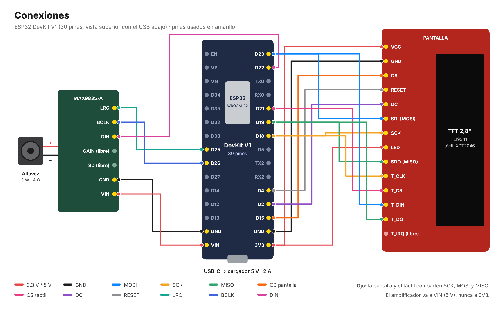

# Guía de montaje

Del paquete de componentes a la pantalla funcionando en la carcasa. Tiempo estimado: **2-3 horas** la primera vez.

<p align="center"></p>

---

## 1. Lista de compra

Precios orientativos en España (octubre de 2026). En AliExpress suelen salir a la mitad, con 2-4 semanas de envío.

| ✔ | Componente | Cant. | Qué buscar exactamente | Precio aprox. |
|:-:|---|:-:|---|--:|
| ☐ | **ESP32 DevKit V1** | 1 | "ESP32 DevKit V1 30 pines WROOM-32", mejor con **USB-C** (chip CP2102 o CH340) | 6-9 € |
| ☐ | **Pantalla TFT 2,8" táctil** | 1 | "TFT 2.8 SPI ILI9341 **XPT2046** touch", la placa roja de 14 pines (≈ 86 × 50 mm). Que diga **ILI9341** y **XPT2046** | 10-12 € |
| ☐ | **Amplificador I2S MAX98357A** | 1 | "MAX98357A I2S amplificador 3W". Suele venir con los pines **sin soldar** | 4-7 € |
| ☐ | **Altavoz** | 1 | "Altavoz 3W 4 ohm 40 mm" (o 28-50 mm según el hueco de la carcasa) | 2-4 € |
| ☐ | **Cables Dupont hembra-hembra** | 1 pack | 20 cm, pack de 40 (sobran) | 3-5 € |
| ☐ | **Cargador USB 5 V · 2 A + cable USB-C de datos** | 1 | El cable tiene que ser **de datos**, no solo de carga (para programar) | 0-10 € |
| ☐ | Servidor (Radxa ROCK 3C / Raspberry Pi) | 1 | Cualquier Linux siempre encendido en tu red | ya lo tienes |
| ☐ | Piezas de construcción | — | Placas y ladrillos para la carcasa | las tuyas |
| | | | **Total** | **≈ 25-45 €** |

**Herramientas:** soldador y estaño (para los pines del amplificador; 10 minutos), cinta de doble cara o masilla adhesiva, y un ordenador con Arduino IDE 2.

> Si no quieres soldar, busca el MAX98357A "con pines soldados" (*pre-soldered headers*) o salta el audio: la pantalla funciona igual sin él.

---

## 2. Preparar el software

1. **Arduino IDE 2** → *Preferencias* → *URLs adicionales de gestor de placas*:
   `https://espressif.github.io/arduino-esp32/package_esp32_index.json`
2. *Gestor de placas* → instala **esp32 de Espressif (versión 3.x)**.
3. *Gestor de librerías* → instala: **ArduinoJson** (v7), **Adafruit GFX Library**, **Adafruit ILI9341** y **XPT2046_Touchscreen**.
4. En `firmware/dashboard_emt/`, copia `secrets.example.h` como `secrets.h` y pon tu WiFi. Pon la IP del servidor en `config.h`.

**Prueba el ESP32 solo antes de cablear nada:** conéctalo por USB, elige la placa **ESP32 Dev Module** y el puerto, y sube el sketch. Si sube sin errores, la placa y el cable están bien.

---

## 3. Conectar la pantalla

> ⚠️ **Siempre con el USB desconectado** mientras cableas.

Son 13 cables. La pantalla y el táctil **comparten** reloj y datos (SCK, MOSI, MISO): de esos pines del ESP32 salen dos cables. Con Dupont hembra-hembra puedes hacerlo con un cable en "Y" o con una mini protoboard.

| # | Pin de la pantalla | → | Pin del ESP32 | Color en el diagrama |
|:-:|---|:-:|---|---|
| 1 | VCC | → | 3V3 | rojo |
| 2 | GND | → | GND (lado derecho) | negro |
| 3 | CS | → | D15 | naranja |
| 4 | RESET | → | D4 | gris |
| 5 | DC | → | D2 | morado |
| 6 | SDI (MOSI) | → | D23 | azul |
| 7 | SCK | → | D18 | amarillo |
| 8 | LED | → | 3V3 | rojo |
| 9 | SDO (MISO) | → | D19 | verde |
| 10 | T_CLK | → | D18 *(compartido con 7)* | amarillo |
| 11 | T_CS | → | D21 | rosa |
| 12 | T_DIN | → | D23 *(compartido con 6)* | azul |
| 13 | T_DO | → | D19 *(compartido con 9)* | verde |
| — | T_IRQ | | sin conectar | |

**Comprobación:** conecta el USB. La pantalla debe encenderse y mostrar *"Conectando WiFi..."*. Si se queda en blanco, revisa VCC, GND, CS, DC y RESET.

---

## 4. Poner en marcha el servidor

En la Radxa (detalles en el [README](../README.md#puesta-en-marcha)):

```bash
cd server
python3 -m venv .venv && source .venv/bin/activate
pip install -r requirements.txt
python3 app.py
```

Comprueba desde otro equipo: `http://<ip-de-la-radxa>:5000/api/parada/<tu-parada>`. Con eso, la pantalla del ESP32 pasará a mostrar las llegadas.

---

## 5. Calibrar el táctil

1. Arduino IDE → *Monitor Serie* a **115200**.
2. Toca el borde **izquierdo** y luego el **derecho**. Verás líneas tipo `Toque: x=3600 y=...`.
3. En `dashboard_emt.ino`:
   - `TOUCH_X_MITAD` = el valor a medio camino entre los dos `x` (por ejemplo, 400 y 3600 → **2000**).
   - Si al tocar a la derecha retrocede en vez de avanzar, pon `TOUCH_INVERTIDO = true`.
4. Vuelve a subir el sketch.

---

## 6. Conectar el audio

1. **Suelda** la tira de pines al MAX98357A y los dos cables del altavoz a su borne (+ y −).
2. Con el USB desconectado:

| # | MAX98357A | → | ESP32 |
|:-:|---|:-:|---|
| 1 | VIN | → | **VIN** (5 V) — *nunca a 3V3* |
| 2 | GND | → | GND (lado izquierdo) |
| 3 | BCLK | → | D26 |
| 4 | LRC | → | D25 |
| 5 | DIN | → | D22 |
| — | GAIN, SD | | sin conectar (volumen medio, siempre encendido) |

3. **Prueba:** en `server/config.py`, pon temporalmente una regla que esté activa ahora mismo, con la franja horaria de este momento y `"andando_min": 0`, sobre una parada con buses cerca. Reinicia el servidor. Cuando un bus esté a 1 minuto, el ESP32 mostrará el banner verde y sonará el aviso. Después deja la regla con tus valores reales.

Volumen: en el firmware, `volumen = 0.6` (de 0.0 a 1.0). Para más potencia conecta GAIN a GND (+12 dB).

---

## 7. Montar en la carcasa

Medidas para diseñar la carcasa:

| Pieza | Medidas aprox. | Consejo |
|---|---|---|
| Pantalla | 86 × 50 × 9 mm (área visible ≈ 58 × 43 mm) | El marco debe tapar solo el borde rojo, no la zona táctil |
| ESP32 DevKit | 52 × 28 mm (+ pines) | Detrás de la pantalla, con el **USB accesible** desde fuera |
| MAX98357A | 18 × 18 mm | Junto al altavoz |
| Altavoz 40 mm | Ø 40 × 20 mm | Mirando hacia fuera, con una rejilla o huecos entre ladrillos |

- Sujeta las placas con cinta de doble cara o masilla, sin apretar los cables.
- Deja algún hueco de ventilación: el ESP32 se calienta un poco con el WiFi.
- Antes de cerrar, prueba que la pantalla responde al tacto en las cuatro esquinas.

---

## 8. Si algo falla

| Síntoma | Causa probable | Solución |
|---|---|---|
| No sube el sketch ("Failed to connect") | Cable solo de carga, o D2/D15 molestan al arrancar | Usa un cable de datos; desconecta los cables de DC (D2) y CS (D15) para subir y vuelve a conectarlos |
| Pantalla en blanco | Falta VCC/GND o CS/DC/RESET mal | Revisa los cables 1-5 de la tabla |
| Imagen pero el táctil no responde | T_CS o los compartidos mal | Revisa T_CS (D21) y los cables "Y" de D18, D19 y D23 |
| El táctil va al revés | Orientación del módulo | `TOUCH_INVERTIDO = true` |
| "Sin conexion al servidor" | IP mal o servidor parado | Revisa `config.h` y que `app.py` esté corriendo |
| "EMT no disponible" | La EMT no responde | Se recupera solo; mientras tanto muestra el último dato (punto naranja) |
| El ESP32 se reinicia al sonar | Cargador flojo | Usa uno de **2 A** |
| Zumbido o ruido | Cables de audio largos | Acorta los cables BCLK, LRC y DIN, o baja el volumen |
